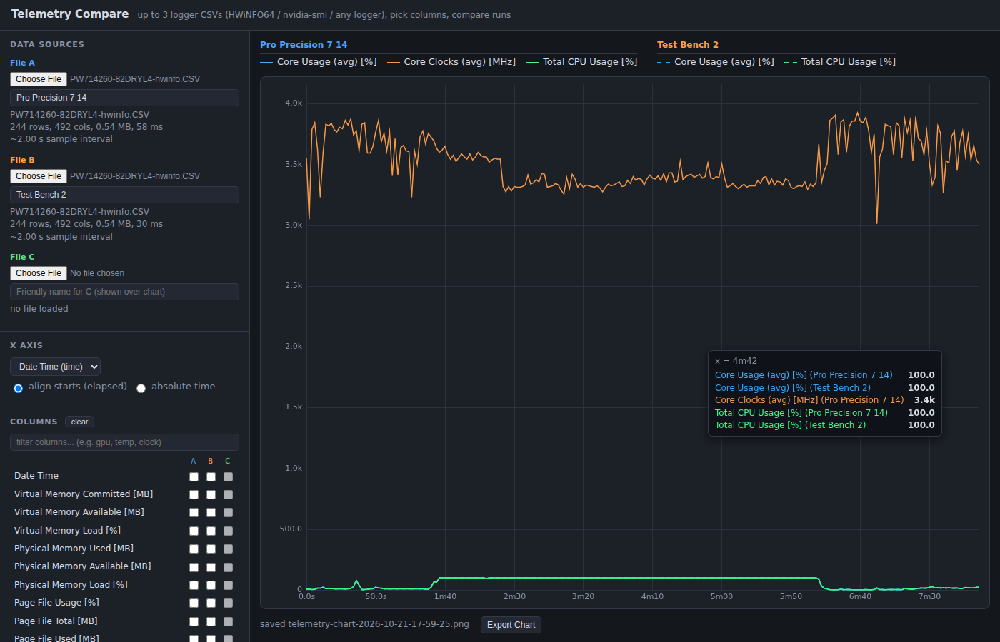

# Telemetry Compare

A single-file, zero-dependency web utility for comparing hardware benchmark
telemetry logs. Open `index.html` in any modern browser - no server, no build,
works fully offline (fine for air-gapped benchmark boxes).



## What it does

- Load up to **3 CSV logs** side by side (slots A / B / C)
- Pick columns to plot with a per-column A/B/C checkbox and a
  type-to-filter box (HWiNFO exports can have 500+ columns)
- Line chart with hover tooltip, drag-to-zoom, double-click reset
- **Friendly names** per file: type a system name (e.g. "Pro Precision 7 14")
  and the legend groups each file's series under a named subsection
- **Export Chart** saves a high-resolution PNG of the chart plus grouped
  legend via the native save dialog
- Y-axis always starts at 0; optional per-series min-max normalize for
  comparing differently-scaled columns
- LTTB ("smart decimate") downsampling keeps 100k+ point logs smooth while
  preserving spikes; recomputed per zoom window

## Supported log formats

Auto-detected, no configuration:

- **HWiNFO64** report CSVs: merged `Date` + `Time` columns, European
  `DD.MM.YYYY` dates, unpadded clock fields (`7:35:0.689`), repeated-header +
  `System:` footer stripped, ANSI or UTF-16 (BOM-sniffed) encoding
- **nvidia-smi** style logs (e.g. a PowerShell poller writing
  `timestamp,gpu_util_pct,...`)
- Any other CSV/semicolon-free table: RFC4180 quoting, `N/A` / unit-suffixed
  values (`45.2 %`), numeric vs text columns auto-typed

Comparisons are intended **same-logger vs same-logger** (the shared time axis
is one column name; mixing loggers falls back to row index for the odd one
out).

## Files

| File | Purpose |
|---|---|
| `index.html` | The whole tool: parser core + UI + canvas charting |
| `test.js` | Node unit tests for the parser core (run `npm test`) |
| `e2e*.js` | Headless-Chrome end-to-end tests (run `npm run test:e2e`) |

The parser core lives at the top of the `<script>` in `index.html` behind a
`module.exports` guard (ignored by the browser). `npm run extract` pulls it
out to `core.js` so node can `require` it.

## Testing

```bash
npm install                # puppeteer-core (tests only; the tool itself has zero deps)
# put sample logs in testData/ (git-ignored) or set TEST_A / TEST_B env vars
npm test                   # parser unit tests
npm run test:e2e           # headless Chrome: load files, click, export PNG
```

## Usage

Just open `index.html` (double-click or `file://`). Drag the exported PNG
straight into reports.
